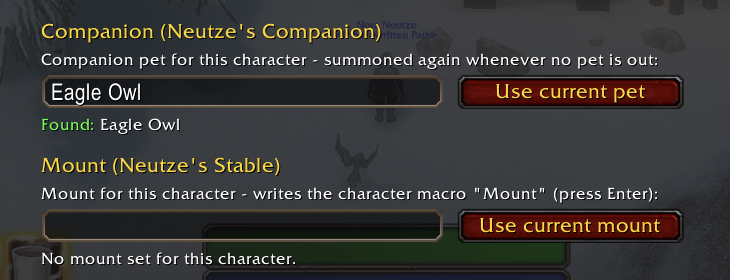

# wow-neutze

Neutze's add-on suite for World of Warcraft: Forever. Every add-on folder in this repo is one add-on; copy the ones you want into `World of Warcraft/_forever_/Interface/AddOns/`.

| Suite | Status |
|---|---|
| **Neutze's Pantry** (below) | v0.0.1 (coming) |
| **Neutze's Companion** (below) | v0.0.1 (coming) |
| **Neutze's Stable** (below) | v0.0.1 (coming) |

## Neutze's Pantry

One macro button per job, always using the **best item in your bags**. Built for World of Warcraft: Forever.

Type `/np` (or `/pantry`, `/neutze`), click a button to create its macro, drop it on your bar. When you carry better items, the macro updates itself (out of combat). Every macro uses the empty "?" icon, so the button shows the item it will use.

| Add-on | What you get |
|---|---|
| **Neutze's Pantry** (core) | The panel, bag scanning and macro updating. Required by all modules. |
| **Neutze's Basics** | Buffet-style buttons: PantryHP (food out of combat; healthstone, then health potion in combat; Hearthstone if no food), PantryMP (drink; mana gem, then mana potion), food only, drink only, potions, healthstone, mana gem, bandage. |
| **Neutze's Well Fed** | Buff food per stat (AutoStamina, AutoAgility, ...), Mana/Health Regen, Hit, Crit, Fire Breath (Dragonbreath Chili), Speed, Armor; AutoWellFed (best food of your top stat) and AutoFishing. Pick your spec in the dropdown (e.g. Shaman: Elemental / Enhancement / Restoration) to set the stat priority. When a stat runs out it falls back to your other Well Fed food, lowest leftover first, following that per-character priority. |
| **Neutze's Elixirs** | Elixirs per stat: ElixirAgility, ElixirFire, ElixirHealth, ... |
| **Neutze's Flasks** | Flasks per stat: FlaskHealth, FlaskSpellPower, FlaskMana, ... |
| **Neutze's Battle Potions** | Short combat potions: PotionRage, PotionFreeAction, PotionSpeed, ... |
| **Neutze's Dynamite** | Engineering explosives: Dynamite, Grenade (stun bombs), Bomb — highest tier first. |
| **Neutze's Alchemy Bombs** | Your strongest alchemy damage item. |

Download the one release zip and turn modules on or off in the AddOns list. `/np list` prints what every macro would use.
Respects Buffet's ignore list if you also run Buffet, but doesn't need it.

Items are recognised from their tooltip text (English client), so new Forever recipes work without an item list.

## Neutze's Companion

Type the companion pet you want on this character (`/nc`, or Options > AddOns > Neutze's Companion). Whenever you have no pet out, it is summoned again: after login, loading screens, landing, dismounting, reviving, eating. A pet you call by hand is left alone.
Never in combat, while stealthed/invisible/feigning death, mounted, on a flight path, casting or eating. Options: put the pet away in stealth (on by default), pause in dungeons, raids and battlegrounds.
Quick set: `/nc Mechanical Squirrel`. Turn off AutoCompanion if you use it, so the two don't fight. With Neutze's Pantry installed, the field is also at the bottom of `/np`.

## Neutze's Stable

Type the mount for this character (bottom of `/np`, or `/stable Swift Palomino`). It writes a character macro **Mount**: mounts that mount, or dismounts if you're mounted. "Use current mount" takes the mount you're sitting on. Change the name and the macro updates.

### Install
Download the release zip and put every `NeutzePantry*`, `NeutzeCompanion` and `NeutzeStable` folder into `World of Warcraft/_forever_/Interface/AddOns/`.

## License
MIT
