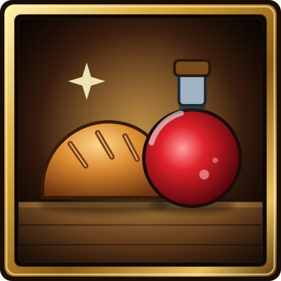
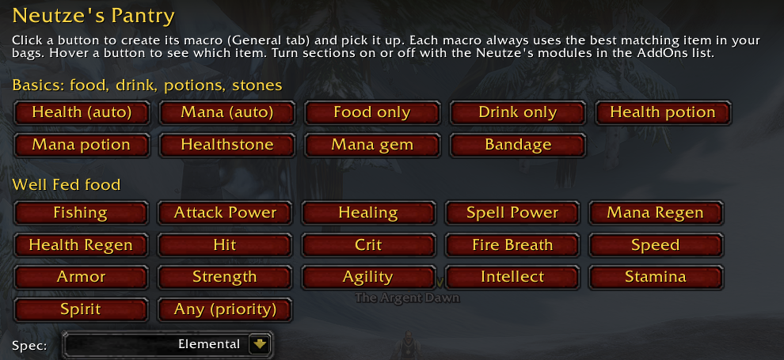
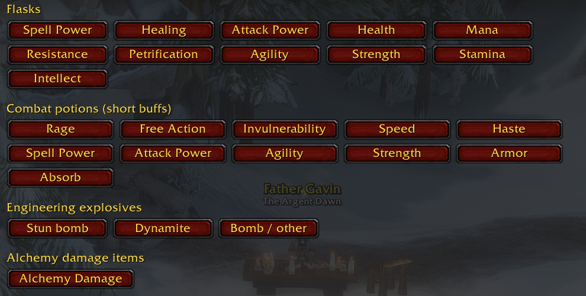

# wow-neutze-pantry

Neutze's Pantry for World of Warcraft: Forever: one core plus modules, each its own add-on. Copy the folders into `World of Warcraft/_forever_/Interface/AddOns/`.

| Suite | Status |
|---|---|
| **Neutze's Pantry** (below) | v0.0.1 |

## Neutze's Pantry

One macro button per job, always using the **best item in your bags**. Built for World of Warcraft: Forever.

Type `/np` (or `/pantry`, `/neutze`) and pick your spec. Each enabled module has its own page under Neutze's Pantry in the options: click a button there to create its macro, then drop it on your bar. When you carry better items, the macro updates itself (out of combat). Every macro uses the empty "?" icon, so the button shows the item it will use.

| Add-on | What you get |
|---|---|
| **Neutze's Pantry** (core) | The panel, bag scanning and macro updating. Required by all modules. |
| **Neutze's Basics** | Buffet-style buttons: NPbaHP (food out of combat; healthstone, then health potion in combat; Hearthstone if no food), NPbaMP (drink; mana gem, then mana potion), food only, drink only, potions, healthstone, mana gem, bandage. |
| **Neutze's Well Fed** | Buff food per stat (NPwfSta, NPwfAgi, ...), Mana/Health Regen, Hit, Crit, Fire Breath (Dragonbreath Chili), Speed, Armor; NPwfBest ("Best for my spec": the best food for your class and spec) and NPwfFish. Pick your class spec in `/np` (right under the Basics) (e.g. Shaman: Elemental / Enhancement / Restoration): food, elixir, flask and potion buttons are then sorted best-first for that spec, and "Best for my spec" eats the right food. When a stat runs out it falls back to your other Well Fed food, lowest leftover first, following that per-character priority. |
| **Neutze's Elixirs** | Elixirs per stat: NPelAgi, NPelFire, NPelHP, ... |
| **Neutze's Flasks** | Flasks per stat: NPflHP, NPflSP, NPflMana, ... |
| **Neutze's Battle Potions** | Short combat potions: NPpoRage, NPpoFree, NPpoSpeed, ... |
| **Neutze's Dynamite** | Engineering explosives: NPexDyn, NPexStun (stun bombs), NPexBomb — highest tier first. |
| **Neutze's Alchemy Bombs** | Your strongest alchemy damage item. |
| **Neutze's Protection Potions** | Fire, Frost, Nature, Shadow, Arcane and Holy Protection, Greater first. |
| **Neutze's Scrolls** | Scroll of Agility, Strength, Stamina, Intellect, Spirit and Protection, sorted for your spec. |
| **Neutze's Juju & Zanza** | Juju, Zanza, the Blasted Lands buffs (R.O.I.D.S., Scorpok, ...) and Winterfall Firewater per stat, sorted for your spec. |
| **Neutze's Runes** | Demonic Rune / Dark Rune. |
| **Neutze's Weapon Buffs** | Sharpening stones, weightstones, wizard and mana oils, rogue poisons. Left-click puts it on the main hand, right-click on the off hand. **Auto** picks by spec and weapon: casters get wizard oil (healers mana oil), everyone else a weightstone on maces and staves and a sharpening stone on edged weapons. |
| **Neutze's Ammunition** | Loads your best arrows (bow, crossbow) or bullets (gun). |
| **Neutze's Pet Food** | Hunters: Feed Pet with the right food for your pet's diet (or a food you pick), and the vendor keeps N stacks of it. Reminds you when your pet is not happy. |
| **Neutze's Alerts** | Reminders. Your Pantry macro **pulses** when Well Fed, an elixir or a flask is missing or has under 2 minutes left (chat line out of combat; sound optional; quiet in cities). Every Pantry macro gets a per-character **keep at least** number: below it the button gets a steady border and a count (orange low, red empty, grey "alt" = fallback), with a chat warning on your last one. **Shopping list** in `/np` and `/np shop`. **Vendor restock**: keep 1, 2, 3 ... stacks of the best drink, plain food and ammunition (arrows or bullets for your weapon) the vendor sells; hold Shift when opening the vendor to skip. |

**Macro names** all start with NP and a two-letter module code, so they sort by module in your General tab: ba Basics, wf Well Fed, el Elixirs, fl Flasks, po Battle Potions, pr Protection, sc Scrolls, ju Juju & Zanza, ru Runes, wb Weapon Buffs, am Ammunition, pf Pet Food, ex Explosives, al Alchemy (Companion: NPcoPet, Stable: NPstMount). Macros from before v0.0.2 (PantryHP, AutoAP, ElixirAgility, ...) are renamed automatically the first time you log in, and they stay on your bars.

Download the one release zip and turn modules on or off in the AddOns list. `/np list` prints what every macro would use.
Respects Buffet's ignore list if you also run Buffet, but doesn't need it.

Items are recognised from their tooltip text (English client), so new Forever recipes work without an item list.

## More from Neutze's
Pantry is the parent of the suite: these need it installed, and their options pages sit under Neutze's Pantry.

- [Neutze's Companion](https://github.com/neutze/wow-neutze-companion): one pet per character, always out. Its field also shows at the bottom of `/np`.
- [Neutze's Stable](https://github.com/neutze/wow-neutze-stable): one mount per character, on a Mount macro. Its field also shows at the bottom of `/np`.
- [Neutze's Macros](https://github.com/neutze/wow-neutze-macros): pick class and spec, click a spell to get its macro.

## Install
With the CurseForge app: search for **Neutze's** and install it for World of Warcraft: Forever.

By hand: download `Neutze-v0.0.1.zip` from [Releases](https://github.com/neutze/wow-neutze-pantry/releases) and put every `NeutzePantry*` folder into `World of Warcraft/_forever_/Interface/AddOns/`. Turn off the modules you don't want in the AddOns list.

## Known limits
- English game client only: items are recognised by their tooltip text.
- No ignore list of its own yet; if Buffet is installed, its ignored items are skipped.
- Macros are only changed out of combat.

Bugs and ideas: [GitHub issues](https://github.com/neutze/wow-neutze-pantry/issues).

## License
MIT
